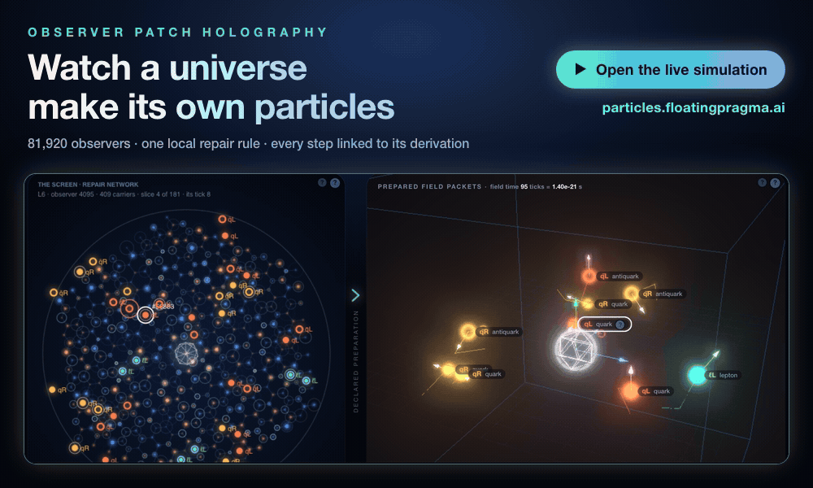

# OPH particles model

**OPH is a rigorous, consistent and complete description of the unified, self-creating computational Universe we inhabit.**

<p align="center">
  <a href="https://particles.floatingpragma.ai/"></a>
</p>

<h3 align="center">▶ <a href="https://particles.floatingpragma.ai/">particles.floatingpragma.ai</a></h3>
<p align="center"><a href="https://particles.floatingpragma.ai/?page=journey">The journey</a> · <a href="https://particles.floatingpragma.ai/about.html">About</a> · <a href="https://floatingpragma.ai/faq/">Reality FAQ</a> · <a href="https://philpapers.org/rec/MUEFOC">Main paper</a> · <a href="https://github.com/FloatingPragma/observer-patch-holography">Theory repository</a></p>

## This repository

The interactive viewer of the OPH particle model, served with GitHub Pages from the `gh-pages` branch: the screen of
observers that run one local repair law, the defects that appear in repair, the particle classes they carry and the
observer's field readout.

## Status

The executable model behind the site is an early calibrated test model. It is the main subject of current research
and is under heavy development.

## Build

The site is built from the simulation repository by `tools/build_site.py` and published to the `gh-pages` branch:

```sh
python tools/build_site.py --only L6 --out site
tools/publish.sh
```

The [full universe runs](https://oph-particles-data-20261111.s3.amazonaws.com/index.html) are separate from the
viewer copies, which retain the screen tier of the stored cuts and catalogue.

[derivations/](derivations/README.md) holds the research reports that the remaining pages cite.
