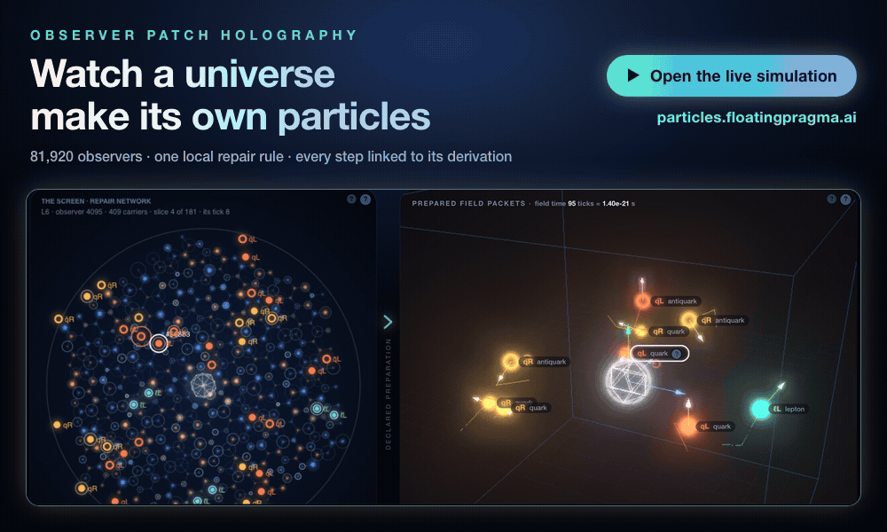

# OPH particles model

**OPH is a rigorous, consistent and complete description of the unified, self-creating computational Universe we inhabit.**

<p align="center">
  <a href="https://particles.floatingpragma.ai/"></a>
</p>

<h3 align="center">▶ <a href="https://particles.floatingpragma.ai/">particles.floatingpragma.ai</a></h3>
<p align="center"><a href="https://particles.floatingpragma.ai/?page=journey">The journey</a> · <a href="https://particles.floatingpragma.ai/?page=matches">Matches with our universe</a> · <a href="https://particles.floatingpragma.ai/about.html">About</a> · <a href="https://philpapers.org/rec/MUEFOC">Main paper</a> · <a href="https://github.com/FloatingPragma/observer-patch-holography">Theory repository</a></p>

## This repository

The interactive viewer of the OPH particle model, served with GitHub Pages: defects appearing in repair on the
screen, the particle classes they carry, the observer's readout and the spectrum.

The site is built from the simulation repository by `tools/build_site.py` and published to the `gh-pages` branch:

```sh
python tools/build_site.py --only L6 --out site
tools/publish.sh
```

The site build projects hadron ratios from the replayable theory analysis in the sibling
`reverse-engineering-reality` checkout. To refresh or verify that projection:

```sh
python tools/sync_hadron_analysis.py
python tools/sync_hadron_analysis.py --check
python tools/sync_particle_reference.py
python tools/sync_thermal_scope.py
python tools/sync_finite_results.py
python tools/sync_finite_results.py --check
python -m unittest discover -s tools -p 'test_*.py'
node tools/test_finite_results.mjs
```

The reference adapter binds the inspected version-two obstruction map in `derivations/work/OM/` by SHA-256 and preserves its 69 model
rows, including their status and input ancestry. Unknown map bytes fail the build. The downloadable Node checks
use the published `rl/` paths and include their required cosmology and lepton fixtures. Scientific text
projections keep the declared number-conserving sector distinct from physical neutrino identification.

The [full universe runs](https://oph-particles-data-20261111.s3.amazonaws.com/index.html) are separate from the
viewer copies, which retain the screen tier of the stored cuts and catalogue. The lattice hadron package
retains reduced measurement tables; these universe archives do not supply its gauge configurations.

The [finite predictions page](https://particles.floatingpragma.ai/finite_results.html) presents complete
lepton-cycle outcomes, reference-inclusive error budgets, exact closed-cell population dynamics, native
conjugation symmetry, correlated hadron errors and cutoff sensitivity. Its data projector rejects stale RER
source bindings. All reported clocks, preparations and physical interpretations retain their stated domains.

The [Journey page](https://particles.floatingpragma.ai/?page=journey) tells the story from the holographic screen
to particle records. The Results group holds the numerical comparisons and their complete list
([Matches to nature](https://particles.floatingpragma.ai/?page=matches)), the board of numbers and status, the
[finite constructions](https://particles.floatingpragma.ai/?page=constructions) with their proofs, and the
[OpenWave status](https://particles.floatingpragma.ai/?page=openwave) of the 31 OpenWave criteria. Values that
answer an OpenWave criterion carry the tag OW n. Refresh the finite constructions on an existing site
without copying pending simulation changes:

```sh
python tools/sync_journey_results.py --out site
python tools/sync_journey_results.py --out site --check
python -m unittest discover -s tools -p 'test_journey_results.py'
node tools/test_journey_results.mjs site
```

The normal full-site builder applies the same overlay. It validates every
source hash before writing, and it refuses a site whose Journey page mounts the results.
The OpenWave status data come from the project's assessment:

```sh
python tools/sync_openwave_status.py --out site/openwave_data.js
python tools/sync_openwave_status.py --out site/openwave_data.js --check
```

The [Results board](https://particles.floatingpragma.ai/?page=results) keeps the best GeV fits visible and adds compact source-pole, resolved-core, cubic-Haar gauge and conditional scalar-curvature rows. These numeric values also appear directly on mobile; assumptions and source intervals open on click.

Run that status refresh after rebuilding the copied viewer so the status and numerical data use the same published RER revision.

The projection binds 132 RER receipts to one committed source revision. The finite-constructions page
shows ten selected tasks, with supporting calculations in a collapsed section. Matches highlights
calibrated proton, neutron, kaon, Lambda and triton energies in GeV, the charged-lepton comparison and
the held-out tau leptonic ratio. The source cards give certified bulk bands, complete transverse-light
and clock records, a fixed-spacing Yang–Mills gap theorem and correlated chronometer comparisons.
Calibration targets, independent comparisons and failed fits have separate labels. Neither the
strong-coupling lattice theorem nor the finite gravity mechanism establishes a continuum theory.

The overlay preserves the Fable viewer and Journey layout. Small, fail-closed data hooks update its existing
Matches rows and OpenWave summaries; calibrated masses and axial strength carry visible calibration labels.
The neutrino table presents both GeV and eV without adding unmeasured absolute masses to the match count.
Match kinds read the final assessment rather than duplicating its statuses. OpenWave tags identify relevant
criteria and do not imply an official award. The platform execution names its pinned upstream member;
the criterion assessment can track a later upstream revision. Separate rigid neutral-hierarchy and
balanced-source mass/threshold failures stay available as controls.

For a clean publication worktree, write the assessment to that same worktree before testing:

```sh
python tools/sync_openwave_status.py --source /path/to/openwave-tuning/application_assessment.json --rer /path/to/reverse-engineering-reality --out /path/to/site/openwave_data.js
python tools/sync_journey_results.py --rer /path/to/reverse-engineering-reality --out /path/to/site
```

Use a current published checkout when applying the overlay: it updates only the bound Results assets and data
hooks. It must not replace concurrently edited simulation files or revert the Early Universe/cosmology page.

The compact Numbers and status board (`?page=results`) uses the same committed-source projection: charged-lepton GeV values, calibrated hadron and nuclear energies, and the held-out tau width ratio. Calibrated rows carry OpenWave row numbers and no independent-fit deviation marker.

Current construction cards show normalizable nucleon and Lambda source records, the calibrated Lambda rest-pole band [1.115684628607, 1.115684878081] GeV, finite autonomous mass-frequency controls, localized native fractional-charge records and complete192-mode CAR transport. The Lambda current-success total mean is a different observable from rest mass, conditioned energy increase and nonselective probe work. Full dynamical electric-field bounds retain the failed helion/alpha comparisons. Energy-dependent full-Haar certificates sharpen both finite source gap intervals while retaining every omitted representation. Complete finite-strength collective geometry controls all49 native positive source/probe pairs at the disclosed observed-G calibration; exact noise/work identities expose its normalization and readout resources. A rigorously enclosed regular long-wavelength cosmological metric coefficient remains distinct from finite-k density growth and CMB observables. These results update the ten existing cards; inputs and limits open on click. Physical interacting spectrum, on-shell decay, independent gravity/cosmic normalization and continuum limits remain open. No additional independent Nature-validation count is awarded.
